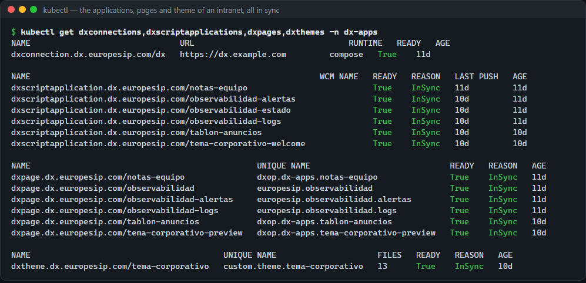
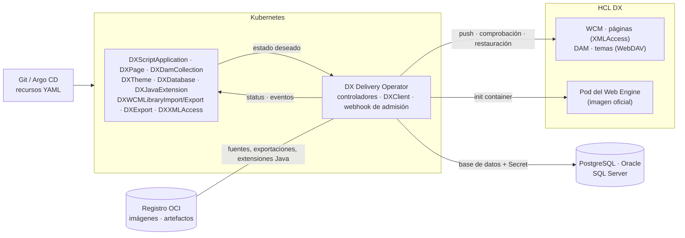
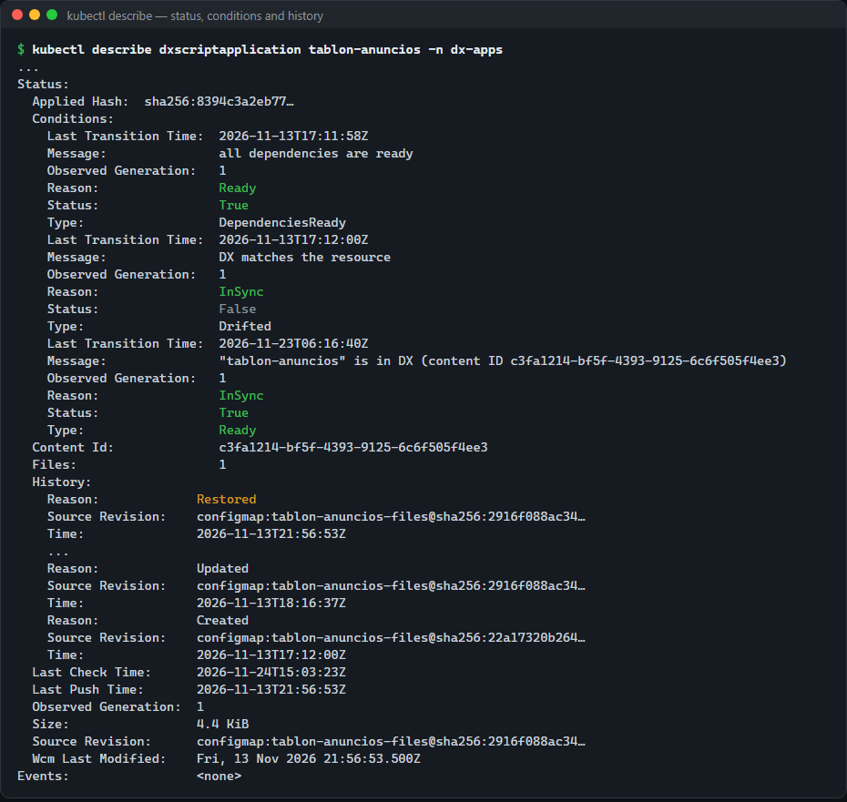
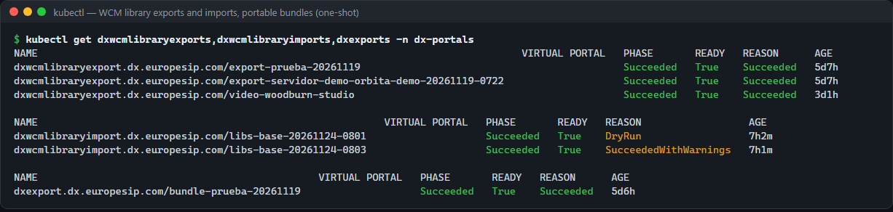

# DX Delivery Operator

[](https://github.com/europesip/dx-delivery-operator/actions/workflows/ci.yml)
[](CHANGELOG.es.md)
[](LICENSE)

[English](README.md) · [Documentación](docs/index.es.md) · [Historial de versiones](CHANGELOG.es.md) · [Hoja de ruta](https://github.com/orgs/europesip/projects/3)

**Entrega aplicaciones y contenido de HCL DX desde Git, al estilo de Kubernetes.** Declaras en YAML una Script
Application, sus páginas, sus ficheros del DAM, su base de datos, un tema o un portlet Java; el operador los pone en
DX, informa de su estado en Kubernetes y los vuelve a dejar como estaban cuando alguien los cambia o los borra en DX.
También lleva librerías WCM, páginas y paquetes de portal completos entre portales como artefactos OCI.

| | |
|---|---|
| **Para quién** | Equipos que tienen HCL DX Compose (o DX Core) en Kubernetes y entregan sus propias aplicaciones y contenido |
| **El problema** | Los push de DXClient son pasos sueltos e imperativos: nada en Kubernetes sabe qué hay en DX, cada cambio repite todo, páginas, DAM y bases de datos necesitan scripts, y lo que se cambia a mano en DX pasa desapercibido |
| **Qué hace** | Convierte cada pieza en un **recurso con un estado deseado y un status**, que se reconcilia continuamente con DX |
| **Qué aporta** | GitOps para DX (Argo CD muestra la salud), la misma compilación en todos los entornos, detección y corrección de cambios, borrados seguros, contenido entre portales en un formato estándar |

No es un producto de HCL. Probado en HCL DX Compose CF239 sobre k3s (Kubernetes 1.35).



## Cómo encaja



## Funciones

| Área | Recursos | Qué obtienes |
|---|---|---|
| **Entregar aplicaciones** | `DXScriptApplication`, `DXPage`, `DXDamCollection`, `DXTheme`, `DXDatabase` | Una Script Application desde una imagen OCI, un ConfigMap o una URL, con `substitutions` por entorno; sus páginas, ficheros del DAM (URL estables), tema y base de datos del backend. Se sube solo si algo cambió; se restaura si se borra o se edita en DX |
| **Llevar contenido entre portales** | `DXWCMLibraryExport`, `DXWCMLibraryImport`, `DXExport`, `DXXMLAccess` | Librerías WCM, la Portal Site, páginas y XMLAccess como artefactos OCI en tu registro, con simulación previa, lotes automáticos y portales virtuales; desde y hacia DX Compose, DX Core y el DX tradicional sobre WebSphere |
| **Java propio en DX Compose** | `DXJavaExtension` | Portlets JSR 168/286 y JAR de librería compartida cargados sobre la imagen **oficial** del Web Engine (sin imagen propia), desplegados pod a pod con vuelta atrás y portlets registrados solos. Ejecutar Java propio en DX Compose exige que el cliente tenga derecho al **Java Transition Module** (JTM) de HCL |
| **Mantenimiento de WCM** | `DXWCMAdminTask` | El *member fixer* y el *workflow checker*, en modo informe salvo que pidas corregir |
| **Todos los recursos** | | `dependsOn` (primero el backend), política de cambios (`Restore` / `Report`), política de borrado (`Retain` / `Delete`), `suspend`, condiciones, eventos de Kubernetes, health checks de Argo CD |

Cada recurso en detalle: [Funciones](docs/features.es.md) · cada campo: [referencia de la API](docs/reference.md).

## Inicio rápido

Requisitos: Kubernetes 1.28+, Helm 3.8+, un usuario de DX (Editor en la Script Application Library; páginas y DAM
necesitan un administrador de DX). **Sin login en ningún registro**: el chart y las imágenes son públicos.

1. **Instalar.** La imagen del operador incluye HCL DXClient, software de HCL con su propia licencia
   ([LICENSE-DXClient.md](LICENSE-DXClient.md)): léela (`docker run --rm hclcr.io/dx-public/dxclient:v95_CF239_20261103-1404 /dxclient/bin/dxclient accept-license`) y acéptala.

   ```bash
   helm upgrade --install dxop oci://ghcr.io/europesip/charts/dx-delivery-operator --version 0.15.0 \
     -n dxop-system --create-namespace --set dxclient.acceptLicense=true
   ```

2. **Conectar con DX** desde el namespace de tus aplicaciones (la CA solo con un certificado autofirmado o privado):

   ```bash
   kubectl create namespace intranet
   kubectl -n intranet create secret generic dx-admin --from-literal=username='<usuario de DX>' --from-literal=password='<contraseña>'
   kubectl -n intranet create secret generic dx-ca --from-file=ca.crt=dx-ca.crt
   ```

   ```yaml
   apiVersion: dx.europesip.com/v1alpha1
   kind: DXConnection
   metadata: { name: dx }
   spec:
     url: https://dx.example.com
     portalCredentialsSecret: { name: dx-admin }
     tlsCASecret: { name: dx-ca }
   ```

3. **Entregar una aplicación y su página:**

   ```yaml
   apiVersion: dx.europesip.com/v1alpha1
   kind: DXScriptApplication
   metadata: { name: time-off }
   spec:
     connectionRef: { name: dx }
     source:
       image: { ref: ghcr.io/acme/time-off:2.3.0, path: /app }   # la aplicación compilada (dist/)
     wcm: { title: "Time off" }
     substitutions:
       - { name: API_URL, value: /time-off-api }                 # ${API_URL} en los ficheros
     dependsOn:
       - { kind: Deployment, name: time-off-api }                # subir solo cuando el backend esté listo
   ---
   apiVersion: dx.europesip.com/v1alpha1
   kind: DXPage
   metadata: { name: time-off }
   spec:
     connectionRef: { name: dx }
     titles: { en: "Time off", es: "Vacaciones" }
     applications: [{ name: time-off }]
   ```

4. **Seguirlo:**

   ```bash
   kubectl -n intranet get dxconnections,dxscriptapplications,dxpages
   kubectl -n intranet get events --field-selector involvedObject.kind=DXScriptApplication
   kubectl -n intranet annotate dxscriptapplication time-off dx.europesip.com/reconcile="$(date +%s)" --overwrite  # forzar ahora
   ```

Valores del chart: [values.yaml](charts/dx-delivery-operator/values.yaml) (por ejemplo `watchNamespaces`). Guías
paso a paso: [Migrar un portal](docs/migration-guide.es.md) · [Extensiones Java](docs/java-extensions.es.md) ·
[DX Core](docs/dx-core.es.md).

## Verlo funcionar

| | |
|---|---|
|  | **Un status fiable.** Las condiciones dicen si las dependencias están listas, si DX coincide con el recurso y el content ID en DX. El historial guarda cada push: `Created`, `Updated` y `Restored` (alguien la borró o la editó en DX y el operador la volvió a dejar) |
|  | **Contenido entre portales.** Exportaciones de librerías WCM a artefactos OCI, importaciones con simulación previa (`DryRun`) y avisos, y paquetes portables, todo como recursos de una sola vez |
|  | **En el portal.** Tres Script Applications de ejemplo en una página creada por el operador: una imagen del DAM, una aplicación con carpetas de ficheros y otra desde un ConfigMap |

Vídeos (en inglés, con subtítulos EN/ES):

| Vídeo | Qué se ve |
|---|---|
| [DX Delivery Operator: Your Whole Portal, Declared in Git](https://youtu.be/JEFRzCmjCtw) | El operador en pocos minutos: aplicaciones, páginas, DAM y temas declarados en Git |
| [DX Delivery Operator: the Complete Tour](https://youtu.be/mY2rUPd9cSU) (9:27) | Todos los recursos, la corrección de cambios en DX, importaciones y exportaciones entre portales |
| [Java Portlets on HCL DX Compose Without a Custom Image](https://youtu.be/bvTHifIU8nA) (8:23) | `DXJavaExtension`: un portlet JSR 286 cargado desde un registro sobre la imagen oficial |
| [Lucía's First Day: HCL DX Compose, Truly Integrated with Your Architecture](https://youtu.be/Aj6zETHoi4k) (9:00) | La historia de una desarrolladora: de Backstage a una aplicación entregada por el operador |

## Ejemplos

Aplicaciones pequeñas, cada una para un caso. Se aplican en un namespace con los dos Secrets y
[00-connection.yaml](samples/00-connection.yaml):

| Ejemplo | Qué muestra |
|---|---|
| [01-hello](samples/01-hello/hello.yaml) | La más pequeña: un HTML en un ConfigMap, sustituciones y una página |
| [02-image](samples/02-image/hello-dx.yaml) | Una aplicación React real ([Hello DX](https://github.com/europesip/hcl-dx-scriptapp-helm)) desde una imagen |
| [03-dam](samples/03-dam/dam.yaml) | Un logo en el DAM (público) y su URL en la aplicación, que espera a la colección |
| [04-backend-db](samples/04-backend-db/visits.yaml) | Un backend ([Go](samples/04-backend-db/visits-api)) con su propia base de datos PostgreSQL, publicado en el host de DX; la aplicación lo espera |
| [05-bundle-image](samples/05-bundle-image) | Una imagen con varios ficheros en carpetas (HTML, CSS, JS): la misma compilación para todos los entornos |
| [06-url](samples/06-url/url.yaml) | Una aplicación desde una URL `.tar.gz` (un tag de GitHub), con su SHA256 |
| [07-verify](samples/07-verify/verify.yaml) | `mode: Verify`: solo comprueba que la aplicación está en DX (entornos con sindicación) |
| [08-page](samples/08-page/page.yaml) | Una página con tres aplicaciones, una posición y una política de borrado |
| [09-theme](samples/09-theme/theme.yaml) | Un tema propio (el [tema de ejemplo de EUROPESIP](https://github.com/europesip/hcl-dx-theme-sample), desde su release) y una página que lo usa |
| [10-wcm-library-import](samples/10-wcm-library-import/wcm-library-import.yaml) | Importar en un portal virtual las librerías WCM de un export de ConfigEngine, después de una simulación |
| [11-xmlaccess](samples/11-xmlaccess/xmlaccess.yaml) | Peticiones XMLAccess propias, en línea o desde Git |
| [12-wcm-library-export](samples/12-wcm-library-export/wcm-library-export.yaml) | Exportar librerías WCM a un artefacto OCI en un registro |
| [13-dx-export](samples/13-dx-export/dx-export.yaml) | Un paquete portable: páginas, Portal Site y librerías WCM en un artefacto |
| [14-wcm-admin-task](samples/14-wcm-admin-task/wcm-admin-task.yaml) | El *member fixer* y el *workflow checker* de WCM, en modo informe |
| [15-dx-core](samples/15-dx-core/dx-core.yaml) | DX Core (DX tradicional sobre WebSphere): su conexión, la exportación de un sitio con su tema y su importación en otro portal |
| [16-java-portlet](samples/16-java-portlet) | Un portlet JSR 286 (EUROPESIP Showcase, público en ghcr.io) desde un registro sobre la imagen oficial del Web Engine, en su propia página (`DXJavaExtension`) |

## GitOps con Argo CD

Los recursos son objetos de Kubernetes normales: van en Git y una Application de Argo CD apunta a ellos. Argo CD los
aplica; el operador hace el trabajo en DX y lo refleja en el status. Con los health checks de
[examples/argocd](examples/argocd), Argo CD los muestra como Progressing, Healthy o Degraded. Publicar una versión
nueva de una aplicación es un commit que cambia la etiqueta (o el digest) de su imagen.

## Por qué un operador y no un Job de Helm

| | Chart de Helm con un Job de DXClient | Operador |
|---|---|---|
| Subir la aplicación | En cada install/upgrade, siempre | **Solo si algo cambió** (hash de ficheros y ajustes) |
| Saber si está en DX | No (log de un Job terminado) | **Sí**: status, condiciones, eventos, `kubectl get` |
| Borrada o editada en DX, DX reinstalado | Pasa desapercibido | **Se detecta y se restaura** en la siguiente comprobación |
| Páginas, DAM, base de datos | Scripts propios por aplicación | **Recursos declarativos**, reutilizables |
| La misma compilación en todos los entornos | Valores metidos en la compilación o en el chart | `substitutions` por entorno |
| Orden (primero el backend) | Pesos de los hooks | `dependsOn`, esperas y reintentos |
| Quitar de DX al desinstalar | A mano | `deletionPolicy: Delete` |
| GitOps (Argo CD) | Los hooks se repiten en cada sync, sin salud | Recursos normales con **salud** |
| Push simultáneos a un DX | Los Jobs pueden chocar | **Serializados** por el operador |

El chart de Helm sigue siendo buena opción para una sola aplicación que se instala una vez. La historia del
operador: [Por qué un operador](docs/why.es.md).

## Plataformas

| | |
|---|---|
| **DX** | DX Compose (por defecto, probado en CF239); [DX Core](docs/dx-core.es.md) (`runtime: core`); el DX tradicional sobre WebSphere como origen o destino de exportaciones e importaciones |
| **Kubernetes** | 1.28+; probado en k3s. El mismo chart funciona en **OpenShift** (`restricted-v2`, sin UID fijo, service CA de OpenShift) sin valores extra, pero **todavía no se ha probado en OpenShift**: [OpenShift y otras plataformas](docs/openshift.es.md) |
| **Instalación** | Chart de Helm `oci://ghcr.io/europesip/charts/dx-delivery-operator`; a partir de él se genera un bundle de OLM para OperatorHub (`make bundle`) |
| **Bases de datos** (`DXDatabase`) | PostgreSQL, Oracle, SQL Server (servidores existentes) |

## Documentación

| | |
|---|---|
| [Funciones](docs/features.es.md) | Cada recurso y lo que el operador hace con él |
| [Cómo funciona](docs/how-it-works.es.md) | Las piezas, el bucle de reconciliación de cada recurso, concurrencia, status y eventos |
| [Guía: migrar un portal, XMLAccess](docs/migration-guide.es.md) | Librerías, Portal Site, páginas, temas y peticiones XMLAccess |
| [Paquetes portables](docs/portable-bundles.es.md) · [Atributos de los artefactos](docs/artifact-annotations.es.md) | El formato de `DXExport` y las anotaciones de cada artefacto |
| [Extensiones Java](docs/java-extensions.es.md) | `DXJavaExtension`: Java propio sobre la imagen oficial del Web Engine |
| [Módulos de mantenimiento de WCM](docs/wcm-admin-tasks.es.md) · [DX Core](docs/dx-core.es.md) · [OpenShift](docs/openshift.es.md) | Casos concretos |
| [Restricciones y limitaciones](docs/limitations.es.md) · [Campos de Secrets](docs/secret-fields.es.md) | Lo que DX permite; de quién es cada credencial |
| [Referencia de la API](docs/reference.md) | Cada campo de cada recurso, generada a partir de los CRD |
| [Cómo trabajamos](docs/workflow.es.md) | Issues, el tablero del proyecto y las especificaciones |

Las mismas páginas se publican como TechDocs en Backstage (`mkdocs.yml`).

## Restricciones y limitaciones

Las importantes (todas en [docs/limitations.es.md](docs/limitations.es.md)):

- **El HTML principal debe ser un documento completo** (`<html><head>…</head><body>…</body></html>`): DXClient
  conserva los `<link>` y `<script>` del `<head>` y el contenido del `<body>`.
- **Cada fichero tiene un límite de 4,5 MB** (un elemento de WCM); el operador rechaza los mayores antes de tocar DX.
- **Las páginas anónimas** necesitan que los usuarios anónimos tengan el rol User en la Script Application Library.
- Una Script Application restaurada tras **borrarse** en DX recibe un **content ID nuevo**; sus páginas se
  reconstruyen.
- Cambiar la **lista de aplicaciones de una página** la vuelve a crear.
- **Push o sindicación, por entorno**: donde el contenido llega por sindicación, `mode: Verify`.
- Los cambios hechos en DX a objetos gestionados **se sobrescriben** (`driftPolicy: Restore`); usa `Report` donde se
  edite en DX.
- **Importación de librerías WCM**: subidas de como máximo 500 MB, nombres de fichero sin espacios, peticiones de 20
  minutos (se resuelve con lotes); Portal Site nunca se importa salvo que se pida.

## Seguridad

- Las credenciales de DX están en Secrets. DXClient las recibe en su fichero de configuración durante cada push
  (nunca en la línea de comandos) y el fichero se borra después; las contraseñas se ocultan en los logs.
- El operador corre como usuario no root y sin privilegios. Puede leer los Secrets y ConfigMaps de los namespaces que
  vigila (limítalos con `watchNamespaces`) y necesita un usuario de DX con los permisos de lo que declares.
- Los valores de `substitutions` acaban en ficheros que cualquier visitante puede descargar: nunca pongas
  credenciales ahí.

## Desarrollo

```bash
make manifests generate && ./hack/sync-chart.sh   # tras cambiar api/
go test ./internal/...
make install                                      # los CRD en el clúster actual
DXCLIENT_HOME=<carpeta de dxclient> DXCLIENT_ACCEPT_LICENSE=true go run ./cmd --leader-elect=false
make bundle                                       # el bundle de OLM, a partir del chart
```

Para ejecutarlo fuera de un contenedor, extrae `/dxclient` de la imagen de DXClient (`crane export ... | tar -x
dxclient`) y usa Node.js 24. Cambió de nombre en la 0.13.0 (hasta la 0.12.x era *HCL DX Script Application operator*;
la API es la misma): [actualizar desde la 0.12.x](CHANGELOG.es.md#0130--2026-11-23).

## Licencia

MIT ([LICENSE](LICENSE)) para este repositorio. La imagen del operador contiene HCL DXClient con la licencia de HCL
([LICENSE-DXClient.md](LICENSE-DXClient.md)). HCL, HCL Digital Experience y DXClient son marcas de HCL Technologies
Ltd. Hecho por [EUROPESIP](https://www.europesip.com).

**Atribución:** cualquier copia o redistribución de este código, modificado o no (también si se rehace con herramientas de IA), debe mantener el aviso de copyright (`Copyright (c) 2026 EUROPESIP`) y el texto de la licencia MIT.
