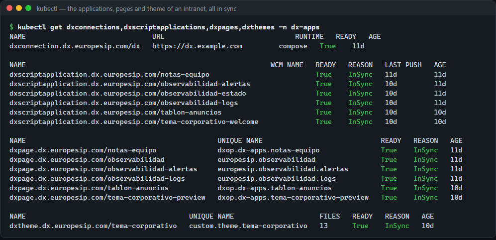
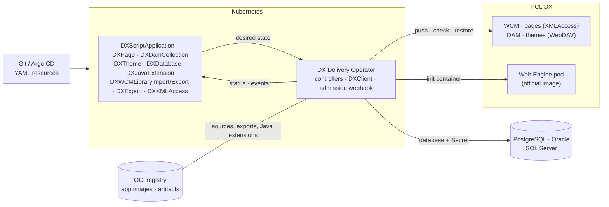
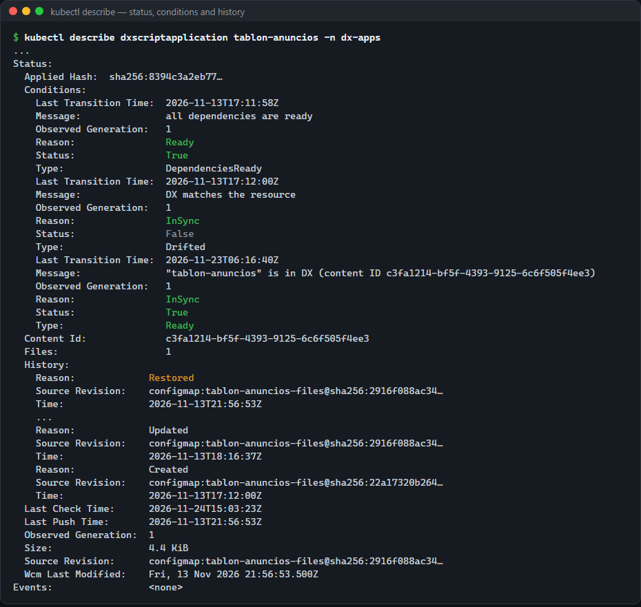
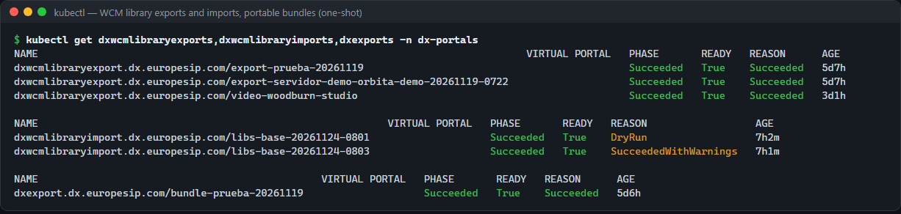

# DX Delivery Operator

[](https://github.com/europesip/dx-delivery-operator/actions/workflows/ci.yml)
[](CHANGELOG.md)
[](LICENSE)
[](https://artifacthub.io/packages/helm/dx-delivery-operator/dx-delivery-operator)
[](https://operatorhub.io/operator/dx-delivery-operator)

[Español](README.es.md) · [Documentation](docs/index.md) · [Release history](CHANGELOG.md) · [Roadmap](https://github.com/orgs/europesip/projects/3)

**Deliver HCL DX applications and content from Git, the Kubernetes way.** Declare a Script Application, its pages,
its DAM files, its database, a theme or a Java portlet in YAML; the operator puts them in DX, reports their state in
Kubernetes and puts them back when someone changes or deletes them in DX. It also moves WCM libraries, pages and whole
portal bundles between portals as OCI artifacts.

| | |
|---|---|
| **For** | Teams that run HCL DX Compose (or DX Core) on Kubernetes and deliver their own applications and content |
| **The problem** | DXClient pushes are one-off, imperative steps: nothing in Kubernetes knows what is in DX, every change is a full re-run, pages, DAM and databases need scripts, and changes made by hand in DX go unnoticed |
| **What it does** | Turns each piece into a **resource with a desired state and a status**, reconciled continuously against DX |
| **Value** | GitOps for DX (Argo CD shows health), the same build in every environment, drift detection and restore, safe deletes, content moved between portals in a standard format |

It is not an HCL product. Tested on HCL DX Compose CF239 on k3s (Kubernetes 1.35).



## How it fits



## Features

| Area | Resources | What you get |
|---|---|---|
| **Deliver applications** | `DXScriptApplication`, `DXPage`, `DXDamCollection`, `DXTheme`, `DXDatabase` | A Script Application from an OCI image, a ConfigMap or a URL, with per-environment `substitutions`; its pages, DAM files (stable URLs), theme and backend database. Pushed only when something changed; restored when deleted or edited in DX |
| **Move content between portals** | `DXWCMLibraryExport`, `DXWCMLibraryImport`, `DXExport`, `DXXMLAccess` | WCM libraries, the Portal Site, pages and XMLAccess as OCI artifacts in your registry, with a dry run first, automatic chunks, virtual portals; to and from DX Compose, DX Core and traditional DX on WebSphere |
| **Custom Java on DX Compose** | `DXJavaExtension` | JSR 168/286 portlets and shared-library JARs loaded onto the **official** Web Engine image (no custom image), rolled out one pod at a time with rollback, portlets registered automatically. Running custom Java on DX Compose requires the customer's entitlement to HCL's **Java Transition Module** (JTM) |
| **Maintain WCM** | `DXWCMAdminTask` | The member fixer and the workflow checker, in report mode unless you ask to fix |
| **Every resource** | | `dependsOn` (backend first), drift policy (`Restore` / `Report`), deletion policy (`Retain` / `Delete`), `suspend`, conditions, Kubernetes events, Argo CD health checks |

Every resource, in detail: [Features](docs/features.md) · every field: [API reference](docs/reference.md).

## Quick start

Requirements: Kubernetes 1.28+, Helm 3.8+, a DX user (Editor on the Script Application Library; pages and DAM need a
DX administrator). **No registry login**: the chart and the images are public.

1. **Install.** The operator image includes HCL DXClient, HCL software under its own licence
   ([LICENSE-DXClient.md](LICENSE-DXClient.md)): read it (`docker run --rm hclcr.io/dx-public/dxclient:v95_CF239_20261103-1404 /dxclient/bin/dxclient accept-license`) and accept it.

   ```bash
   helm upgrade --install dxop oci://ghcr.io/europesip/charts/dx-delivery-operator --version 0.17.0 \
     -n dxop-system --create-namespace --set dxclient.acceptLicense=true
   ```

2. **Connect to DX** from the namespace of your applications (the CA only for a self-signed or private certificate):

   ```bash
   kubectl create namespace intranet
   kubectl -n intranet create secret generic dx-admin --from-literal=username='<DX user>' --from-literal=password='<password>'
   kubectl -n intranet create secret generic dx-ca --from-file=ca.crt=dx-ca.crt
   ```

   ```yaml
   apiVersion: dx.europesip.com/v1alpha1
   kind: DXConnection
   metadata: { name: dx }
   spec:
     url: https://dx.example.com
     portalCredentialsSecret: { name: dx-admin }
     tlsCASecret: { name: dx-ca }
   ```

3. **Deliver an application and its page:**

   ```yaml
   apiVersion: dx.europesip.com/v1alpha1
   kind: DXScriptApplication
   metadata: { name: time-off }
   spec:
     connectionRef: { name: dx }
     source:
       image: { ref: ghcr.io/acme/time-off:2.3.0, path: /app }   # the built app (dist/)
     wcm: { title: "Time off" }
     substitutions:
       - { name: API_URL, value: /time-off-api }                 # ${API_URL} in the files
     dependsOn:
       - { kind: Deployment, name: time-off-api }                # push only when the backend is up
   ---
   apiVersion: dx.europesip.com/v1alpha1
   kind: DXPage
   metadata: { name: time-off }
   spec:
     connectionRef: { name: dx }
     titles: { en: "Time off", es: "Vacaciones" }
     applications: [{ name: time-off }]
   ```

4. **Watch it:**

   ```bash
   kubectl -n intranet get dxconnections,dxscriptapplications,dxpages
   kubectl -n intranet get events --field-selector involvedObject.kind=DXScriptApplication
   kubectl -n intranet annotate dxscriptapplication time-off dx.europesip.com/reconcile="$(date +%s)" --overwrite  # force now
   ```

Values of the chart: [values.yaml](charts/dx-delivery-operator/values.yaml) (for example `watchNamespaces`).
Step-by-step guides: [Migrate a portal](docs/migration-guide.md) · [Java extensions](docs/java-extensions.md) ·
[DX Core](docs/dx-core.md).

## Install from a catalog: OperatorHub.io or Artifact Hub

The same operator is published in two public catalogs. Use the one that fits how you run your cluster; the Helm
command of the quick start keeps working as well.

| | [OperatorHub.io](https://operatorhub.io/operator/dx-delivery-operator) (OLM) | [Artifact Hub](https://artifacthub.io/packages/helm/dx-delivery-operator/dx-delivery-operator) (Helm chart) |
|---|---|---|
| **What you install** | The OLM bundle, through a `Subscription` | The Helm chart `oci://ghcr.io/europesip/charts/dx-delivery-operator` |
| **Upgrades** | **Automatic** from channel `alpha` (or with manual approval: `installPlanApproval: Manual`) | You choose when: `helm upgrade --version …`; Artifact Hub can e-mail you when a new version is out |
| **CRDs and RBAC** | Installed and upgraded by OLM | Installed by the chart |
| **Best for** | Clusters that already use OLM, and OpenShift (where OperatorHub is built into the console) | Helm and Argo CD users; teams that want to read the values, the CRDs and the images before installing |
| **Extra** | One standard way to install and update all your operators | Verified publisher, security report of the images, values and CRD reference, release history |

**From OperatorHub.io.** On a cluster with OLM (OperatorHub.io gives the commands to install it), create the
Subscription; the HCL DXClient licence is accepted here (see step 1 of the quick start):

```yaml
apiVersion: operators.coreos.com/v1alpha1
kind: Subscription
metadata:
  name: dx-delivery-operator
  namespace: operators
spec:
  channel: alpha
  name: dx-delivery-operator
  source: operatorhubio-catalog
  sourceNamespace: olm
  config:
    env:
      - name: DXCLIENT_ACCEPT_LICENSE
        value: "true"
```

**From Artifact Hub.** Open the package page, press *Install* and copy the command: it is the same chart as in the
quick start, published by the verified publisher EUROPESIP. Press *Subscribe* (bell icon) to be told about new versions.

The OpenShift community catalog (OperatorHub inside the OpenShift console) is in review:
[OpenShift and other platforms](docs/openshift.md#operatorhub-olm-bundle).

## See it working

| | |
|---|---|
|  | **Status you can trust.** Conditions say whether the dependencies are ready, whether DX matches the resource and the content ID in DX. The history records every push: `Created`, `Updated` and `Restored` (someone deleted or edited it in DX, the operator put it back) |
|  | **Content between portals.** WCM library exports to OCI artifacts, imports with a dry run first (`DryRun`) and warnings reported, and portable bundles, all as one-shot resources |
|  | **In the portal.** Three sample Script Applications on one page created by the operator: a DAM image, an application with folders of files and a ConfigMap one |

Videos (English, subtitles EN/ES):

| Video | What you see |
|---|---|
| [DX Delivery Operator: Your Whole Portal, Declared in Git](https://youtu.be/JEFRzCmjCtw) | The operator in a few minutes: applications, pages, DAM and themes declared in Git |
| [DX Delivery Operator: the Complete Tour](https://youtu.be/mY2rUPd9cSU) (9:27) | Every resource, drift correction, imports and exports between portals |
| [Java Portlets on HCL DX Compose Without a Custom Image](https://youtu.be/bvTHifIU8nA) (8:23) | `DXJavaExtension`: a JSR 286 portlet loaded from a registry onto the official image |
| [Lucía's First Day: HCL DX Compose, Truly Integrated with Your Architecture](https://youtu.be/Aj6zETHoi4k) (9:00) | A developer story: from Backstage to an application delivered by the operator |

## Samples

Small applications, each one showing one case. Apply them in a namespace with the two Secrets and
[00-connection.yaml](samples/00-connection.yaml):

| Sample | What it shows |
|---|---|
| [01-hello](samples/01-hello/hello.yaml) | The smallest one: one HTML file in a ConfigMap, substitutions, a page |
| [02-image](samples/02-image/hello-dx.yaml) | A real React application ([Hello DX](https://github.com/europesip/hcl-dx-scriptapp-helm)) from a bundle image |
| [03-dam](samples/03-dam/dam.yaml) | A logo in the DAM (public) and its URL in the application, which waits for the collection |
| [04-backend-db](samples/04-backend-db/visits.yaml) | A backend ([Go](samples/04-backend-db/visits-api)) with its own PostgreSQL database, published on the DX host; the application waits for it |
| [05-bundle-image](samples/05-bundle-image) | A bundle image with several files in folders (HTML, CSS, JS), the same build for every environment |
| [06-url](samples/06-url/url.yaml) | An application from a `.tar.gz` URL (a GitHub tag), with its SHA256 |
| [07-verify](samples/07-verify/verify.yaml) | `mode: Verify`: only check that an application is in DX (syndicated environments) |
| [08-page](samples/08-page/page.yaml) | One page with three applications, a position and a deletion policy |
| [09-theme](samples/09-theme/theme.yaml) | A theme of its own (the [EUROPESIP sample theme](https://github.com/europesip/hcl-dx-theme-sample), from its release) and a page that uses it |
| [10-wcm-library-import](samples/10-wcm-library-import/wcm-library-import.yaml) | Import the WCM libraries of a ConfigEngine export into a virtual portal, after a dry run |
| [11-xmlaccess](samples/11-xmlaccess/xmlaccess.yaml) | Your own XMLAccess requests, inline or from Git |
| [12-wcm-library-export](samples/12-wcm-library-export/wcm-library-export.yaml) | Export WCM libraries to an OCI artifact in a registry |
| [13-dx-export](samples/13-dx-export/dx-export.yaml) | A portable bundle: pages, Portal Site and WCM libraries in one artifact |
| [14-wcm-admin-task](samples/14-wcm-admin-task/wcm-admin-task.yaml) | The WCM member fixer and workflow checker, in report mode |
| [15-dx-core](samples/15-dx-core/dx-core.yaml) | DX Core (traditional DX on WebSphere): its connection, the export of a site with its theme, and its import into another portal |
| [16-java-portlet](samples/16-java-portlet) | A JSR 286 portlet (EUROPESIP Showcase, public on ghcr.io) from a registry onto the official Web Engine image, on its own page (`DXJavaExtension`) |

## GitOps with Argo CD

The resources are plain Kubernetes objects: put them in Git and point an Argo CD Application at them. Argo CD
applies them; the operator does the work in DX and reports it in the status. Add the health checks of
[examples/argocd](examples/argocd) so Argo CD shows them as Progressing, Healthy or Degraded. Releasing a new version
of an application is then a commit that changes its image tag (or digest).

## Why an operator, not a Helm Job

| | Helm chart with a DXClient Job | Operator |
|---|---|---|
| Push the application | On every install/upgrade, always | **Only when something changed** (hash of files and settings) |
| Know if it is in DX | No (log of a finished Job) | **Yes**: status, conditions, events, `kubectl get` |
| Deleted or edited in DX, DX reinstalled | Unnoticed | **Detected and restored** on the next check |
| Pages, DAM, database | Custom scripts per application | **Declarative resources**, reusable |
| Same build in every environment | Values baked into the build or the chart | `substitutions` per environment |
| Order (backend first) | Hook weights | `dependsOn`, waits and retries |
| Remove from DX on uninstall | Manual | `deletionPolicy: Delete` |
| GitOps (Argo CD) | Hooks re-run on every sync, no health | Plain resources with **health** |
| Concurrent pushes to one DX | Jobs can collide | **Serialised** by the operator |

The Helm chart is still a good choice for a single application installed once. The story behind the operator:
[Why an operator](docs/why.md).

## Platforms

| | |
|---|---|
| **DX** | DX Compose (default, tested on CF239); [DX Core](docs/dx-core.md) (`runtime: core`); traditional DX on WebSphere as source or target of exports and imports |
| **Kubernetes** | 1.28+; tested on k3s. The same chart runs on **OpenShift** (`restricted-v2`, no fixed UID, OpenShift service CA) without extra values, but it **has not been tested on OpenShift yet**: [OpenShift and other platforms](docs/openshift.md) |
| **Install** | Helm chart `oci://ghcr.io/europesip/charts/dx-delivery-operator`; an OLM bundle generated from it (`make bundle`) is published on [OperatorHub.io](https://operatorhub.io/operator/dx-delivery-operator) and the chart on [Artifact Hub](https://artifacthub.io/packages/helm/dx-delivery-operator/dx-delivery-operator) ([which one to use](#install-from-a-catalog-operatorhubio-or-artifact-hub)); the OpenShift community catalog submission is in review ([details](docs/openshift.md#operatorhub-olm-bundle)) |
| **Databases** (`DXDatabase`) | PostgreSQL, Oracle, SQL Server (existing servers) |

## Documentation

| | |
|---|---|
| [Features](docs/features.md) | Every resource and what the operator does with it |
| [How it works](docs/how-it-works.md) | The pieces, the reconciliation loop of each resource, concurrency, status and events |
| [Guide: migrate a portal, XMLAccess](docs/migration-guide.md) | Libraries, Portal Site, pages, themes and XMLAccess requests |
| [Portable bundles](docs/portable-bundles.md) · [Artifact annotations](docs/artifact-annotations.md) | The `DXExport` format and the annotations every artifact carries |
| [Java extensions](docs/java-extensions.md) | `DXJavaExtension`: custom Java on the official Web Engine image |
| [WCM maintenance modules](docs/wcm-admin-tasks.md) · [DX Core](docs/dx-core.md) · [OpenShift](docs/openshift.md) | Specific cases |
| [Restrictions and limitations](docs/limitations.md) · [Secret fields](docs/secret-fields.md) | What DX allows; whose credentials go where |
| [API reference](docs/reference.md) | Every field of every resource, generated from the CRDs |
| [How we work](docs/workflow.md) | Issues, the project board and the specs |

The same pages are published as TechDocs in Backstage (`mkdocs.yml`).

## Restrictions and limitations

The important ones (all of them in [docs/limitations.md](docs/limitations.md)):

- **The main HTML file must be a complete document** (`<html><head>…</head><body>…</body></html>`): DXClient keeps
  the `<link>` and `<script>` of the `<head>` and the content of the `<body>`.
- **Each file is limited to 4.5 MB** (one WCM element); the operator refuses bigger files before touching DX.
- **Anonymous pages** need anonymous users to have the User role on the Script Application Library.
- A Script Application restored after being **deleted** in DX gets a **new content ID**; its pages are rebuilt.
- Changing the **list of applications of a page** recreates the page.
- **Push or syndication, per environment**: where content arrives by syndication, use `mode: Verify`.
- Edits made in DX to managed objects are **overwritten** (`driftPolicy: Restore`); use `Report` where people edit
  in DX.
- **WCM library imports**: uploads of at most 500 MB, file names without spaces, 20-minute requests (handled with
  chunks); Portal Site is never imported unless asked.

## Security

- The DX credentials stay in Secrets. DXClient gets them in its configuration file during each push (never on a
  command line) and the file is removed afterwards; passwords are redacted from logs.
- The operator runs as a non-root user without privileges. It can read the Secrets and ConfigMaps of the namespaces
  it watches (limit them with `watchNamespaces`) and needs a DX user with the rights of what you declare.
- Values of `substitutions` end up in files every visitor can download: never put credentials there.

## Development

```bash
make manifests generate && ./hack/sync-chart.sh   # after changing api/
go test ./internal/...
make install                                      # the CRDs into the current cluster
DXCLIENT_HOME=<dxclient folder> DXCLIENT_ACCEPT_LICENSE=true go run ./cmd --leader-elect=false
make bundle                                       # the OLM bundle, from the chart
```

To run it outside a container, extract `/dxclient` from the DXClient image (`crane export ... | tar -x dxclient`) and
use Node.js 24. Renamed in 0.13.0 (it was *HCL DX Script Application operator* until 0.12.x; same API):
[upgrading from 0.12.x](CHANGELOG.md#0130--2026-11-23).

## Licence

MIT ([LICENSE](LICENSE)) for this repository. The operator image contains HCL DXClient under HCL's licence
([LICENSE-DXClient.md](LICENSE-DXClient.md)). HCL, HCL Digital Experience and DXClient are trademarks of HCL
Technologies Ltd. Made by [EUROPESIP](https://www.europesip.com).

**Attribution:** any copy or redistribution of this code, modified or not (also when it is reworked with AI tools), must keep the copyright notice (`Copyright (c) 2026 EUROPESIP`) and the MIT licence text.
