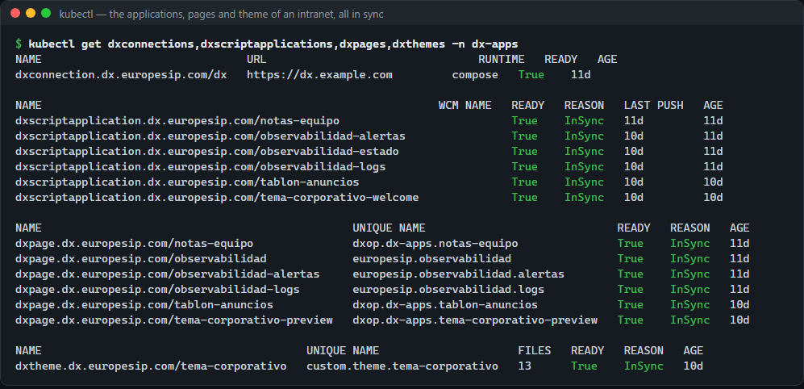
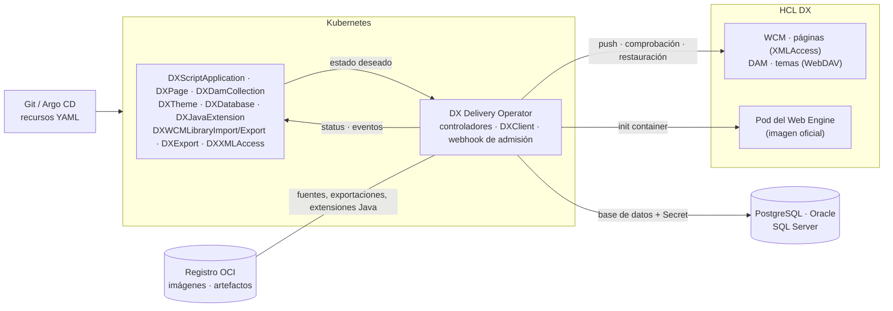
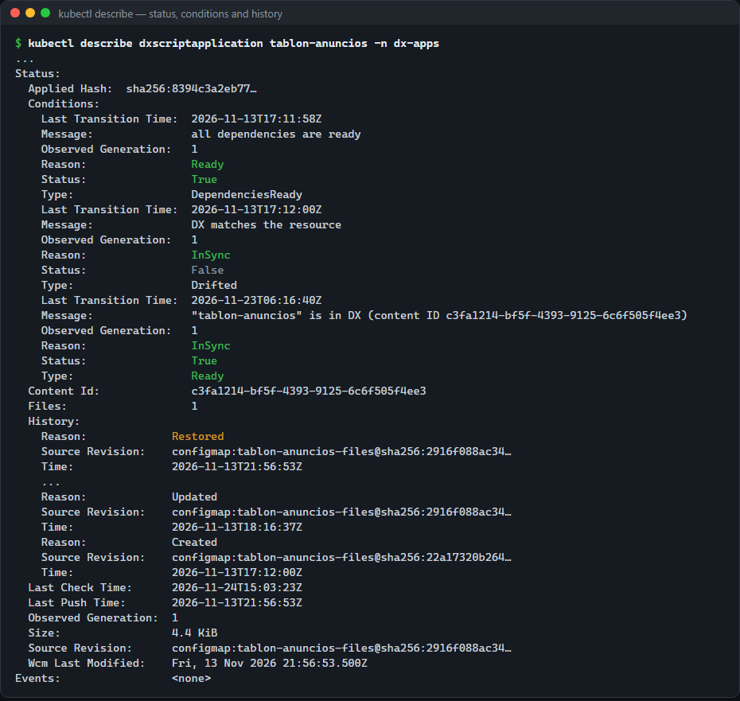
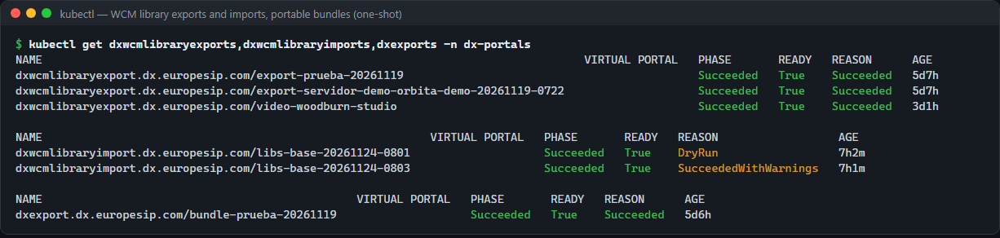

# DX Delivery Operator

[English](index.md) · **Español** · [Código en GitHub](https://github.com/europesip/dx-delivery-operator)

**Entrega aplicaciones y contenido de HCL DX desde Git, al estilo de Kubernetes.** Declaras en YAML una Script
Application, sus páginas, sus ficheros del DAM, su base de datos, un tema o un portlet Java; el operador los pone en
DX, informa de su estado en Kubernetes y los vuelve a dejar como estaban cuando alguien los cambia o los borra en DX.
También lleva librerías WCM, páginas y paquetes de portal completos entre portales como artefactos OCI.

| | |
|---|---|
| **Para quién** | Equipos que tienen HCL DX Compose (o DX Core) en Kubernetes y entregan sus propias aplicaciones y contenido |
| **El problema** | Los push de DXClient son pasos sueltos e imperativos: nada en Kubernetes sabe qué hay en DX, cada cambio repite todo, páginas, DAM y bases de datos necesitan scripts, y lo que se cambia a mano en DX pasa desapercibido |
| **Qué hace** | Convierte cada pieza en un **recurso con un estado deseado y un status**, que se reconcilia continuamente con DX |
| **Qué aporta** | GitOps para DX (Argo CD muestra la salud), la misma compilación en todos los entornos, detección y corrección de cambios, borrados seguros, contenido entre portales en un formato estándar |

No es un producto de HCL. Probado en HCL DX Compose CF239 sobre k3s (Kubernetes 1.35).



## Cómo encaja



## Funciones

| Área | Recursos | Qué obtienes |
|---|---|---|
| **Entregar aplicaciones** | `DXScriptApplication`, `DXPage`, `DXDamCollection`, `DXTheme`, `DXDatabase` | Una Script Application desde una imagen OCI, un ConfigMap o una URL, con `substitutions` por entorno; sus páginas, ficheros del DAM (URL estables), tema y base de datos del backend. Se sube solo si algo cambió; se restaura si se borra o se edita en DX |
| **Llevar contenido entre portales** | `DXWCMLibraryExport`, `DXWCMLibraryImport`, `DXExport`, `DXXMLAccess` | Librerías WCM, la Portal Site, páginas y XMLAccess como artefactos OCI en tu registro, con simulación previa, lotes automáticos y portales virtuales; desde y hacia DX Compose, DX Core y el DX tradicional sobre WebSphere |
| **Java propio en DX Compose** | `DXJavaExtension` | Portlets JSR 168/286 y JAR de librería compartida cargados sobre la imagen **oficial** del Web Engine (sin imagen propia), desplegados pod a pod con vuelta atrás y portlets registrados solos. Ejecutar Java propio en DX Compose exige que el cliente tenga derecho al **Java Transition Module** (JTM) de HCL |
| **Mantenimiento de WCM** | `DXWCMAdminTask` | El *member fixer* y el *workflow checker*, en modo informe salvo que pidas corregir |
| **Todos los recursos** | | `dependsOn` (primero el backend), política de cambios (`Restore` / `Report`), política de borrado (`Retain` / `Delete`), `suspend`, condiciones, eventos de Kubernetes, health checks de Argo CD |

Cada recurso en detalle: [Funciones](features.es.md) · cada campo: [referencia de la API](reference.md).

## Inicio rápido

Requisitos: Kubernetes 1.28+, Helm 3.8+, un usuario de DX (Editor en la Script Application Library; páginas y DAM
necesitan un administrador de DX). **Sin login en ningún registro**: el chart y las imágenes son públicos.

1. **Instalar.** La imagen del operador incluye HCL DXClient, software de HCL con su propia licencia
   ([LICENSE-DXClient.md](https://github.com/europesip/dx-delivery-operator/blob/main/LICENSE-DXClient.md)): léela (`docker run --rm hclcr.io/dx-public/dxclient:v95_CF239_20261103-1404 /dxclient/bin/dxclient accept-license`) y acéptala.

   ```bash
   helm upgrade --install dxop oci://ghcr.io/europesip/charts/dx-delivery-operator --version 0.15.0 \
     -n dxop-system --create-namespace --set dxclient.acceptLicense=true
   ```

2. **Conectar con DX** desde el namespace de tus aplicaciones (la CA solo con un certificado autofirmado o privado):

   ```bash
   kubectl create namespace intranet
   kubectl -n intranet create secret generic dx-admin --from-literal=username='<usuario de DX>' --from-literal=password='<contraseña>'
   kubectl -n intranet create secret generic dx-ca --from-file=ca.crt=dx-ca.crt
   ```

   ```yaml
   apiVersion: dx.europesip.com/v1alpha1
   kind: DXConnection
   metadata: { name: dx }
   spec:
     url: https://dx.example.com
     portalCredentialsSecret: { name: dx-admin }
     tlsCASecret: { name: dx-ca }
   ```

3. **Entregar una aplicación y su página:**

   ```yaml
   apiVersion: dx.europesip.com/v1alpha1
   kind: DXScriptApplication
   metadata: { name: time-off }
   spec:
     connectionRef: { name: dx }
     source:
       image: { ref: ghcr.io/acme/time-off:2.3.0, path: /app }   # la aplicación compilada (dist/)
     wcm: { title: "Time off" }
     substitutions:
       - { name: API_URL, value: /time-off-api }                 # ${API_URL} en los ficheros
     dependsOn:
       - { kind: Deployment, name: time-off-api }                # subir solo cuando el backend esté listo
   ---
   apiVersion: dx.europesip.com/v1alpha1
   kind: DXPage
   metadata: { name: time-off }
   spec:
     connectionRef: { name: dx }
     titles: { en: "Time off", es: "Vacaciones" }
     applications: [{ name: time-off }]
   ```

4. **Seguirlo:**

   ```bash
   kubectl -n intranet get dxconnections,dxscriptapplications,dxpages
   kubectl -n intranet get events --field-selector involvedObject.kind=DXScriptApplication
   kubectl -n intranet annotate dxscriptapplication time-off dx.europesip.com/reconcile="$(date +%s)" --overwrite  # forzar ahora
   ```

Valores del chart: [values.yaml](https://github.com/europesip/dx-delivery-operator/blob/main/charts/dx-delivery-operator/values.yaml) (por ejemplo `watchNamespaces`). Guías
paso a paso: [Migrar un portal](migration-guide.es.md) · [Extensiones Java](java-extensions.es.md) ·
[DX Core](dx-core.es.md).

## Verlo funcionar

| | |
|---|---|
|  | **Un status fiable.** Las condiciones dicen si las dependencias están listas, si DX coincide con el recurso y el content ID en DX. El historial guarda cada push: `Created`, `Updated` y `Restored` (alguien la borró o la editó en DX y el operador la volvió a dejar) |
|  | **Contenido entre portales.** Exportaciones de librerías WCM a artefactos OCI, importaciones con simulación previa (`DryRun`) y avisos, y paquetes portables, todo como recursos de una sola vez |
|  | **En el portal.** Tres Script Applications de ejemplo en una página creada por el operador: una imagen del DAM, una aplicación con carpetas de ficheros y otra desde un ConfigMap |

Vídeo: [Portlets Java en HCL DX Compose sin imagen propia](https://youtu.be/bvTHifIU8nA) (8 min, subtítulos EN/ES).

## Plataformas

| | |
|---|---|
| **DX** | DX Compose (por defecto, probado en CF239); [DX Core](dx-core.es.md) (`runtime: core`); el DX tradicional sobre WebSphere como origen o destino de exportaciones e importaciones |
| **Kubernetes** | 1.28+; probado en k3s. El mismo chart funciona en **OpenShift** (`restricted-v2`, sin UID fijo, service CA de OpenShift) sin valores extra, pero **todavía no se ha probado en OpenShift**: [OpenShift y otras plataformas](openshift.es.md) |
| **Instalación** | Chart de Helm `oci://ghcr.io/europesip/charts/dx-delivery-operator`; a partir de él se genera un bundle de OLM para OperatorHub (`make bundle`) |
| **Bases de datos** (`DXDatabase`) | PostgreSQL, Oracle, SQL Server (servidores existentes) |

## Documentación

| | |
|---|---|
| [Funciones](features.es.md) | Cada recurso y lo que el operador hace con él |
| [Cómo funciona](how-it-works.es.md) | Las piezas, el bucle de reconciliación de cada recurso, concurrencia, status y eventos |
| [Guía: migrar un portal, XMLAccess](migration-guide.es.md) | Librerías, Portal Site, páginas, temas y peticiones XMLAccess |
| [Paquetes portables](portable-bundles.es.md) · [Atributos de los artefactos](artifact-annotations.es.md) | El formato de `DXExport` y las anotaciones de cada artefacto |
| [Extensiones Java](java-extensions.es.md) | `DXJavaExtension`: Java propio sobre la imagen oficial del Web Engine |
| [Módulos de mantenimiento de WCM](wcm-admin-tasks.es.md) · [DX Core](dx-core.es.md) · [OpenShift](openshift.es.md) | Casos concretos |
| [Restricciones y limitaciones](limitations.es.md) · [Campos de Secrets](secret-fields.es.md) | Lo que DX permite; de quién es cada credencial |
| [Referencia de la API](reference.md) | Cada campo de cada recurso, generada a partir de los CRD |
| [Cómo trabajamos](workflow.es.md) | Issues, el tablero del proyecto y las especificaciones |

Las mismas páginas se publican como TechDocs en Backstage (`mkdocs.yml`).

## Licencia

MIT ([LICENSE](https://github.com/europesip/dx-delivery-operator/blob/main/LICENSE)) para este repositorio. La imagen del operador contiene HCL DXClient con la licencia de HCL
([LICENSE-DXClient.md](https://github.com/europesip/dx-delivery-operator/blob/main/LICENSE-DXClient.md)). HCL, HCL Digital Experience y DXClient son marcas de HCL Technologies
Ltd. Hecho por [EUROPESIP](https://www.europesip.com).
