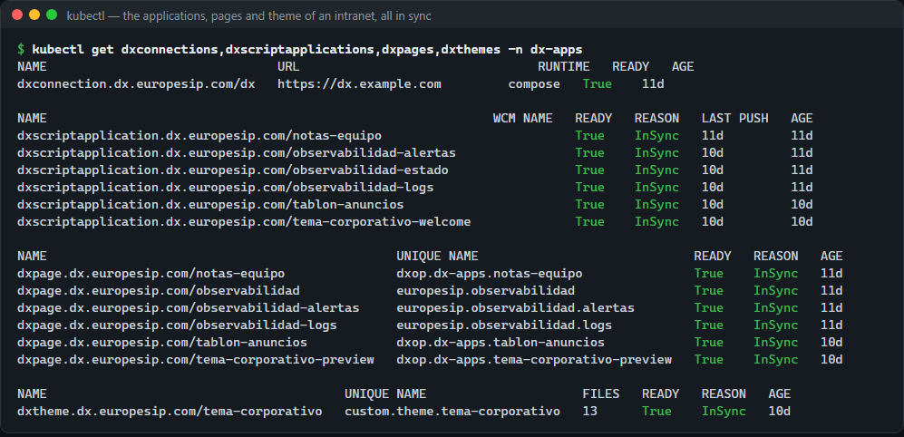
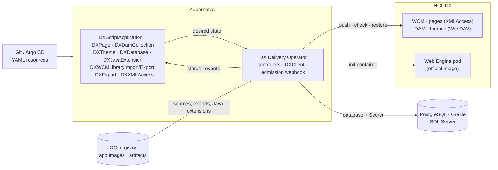
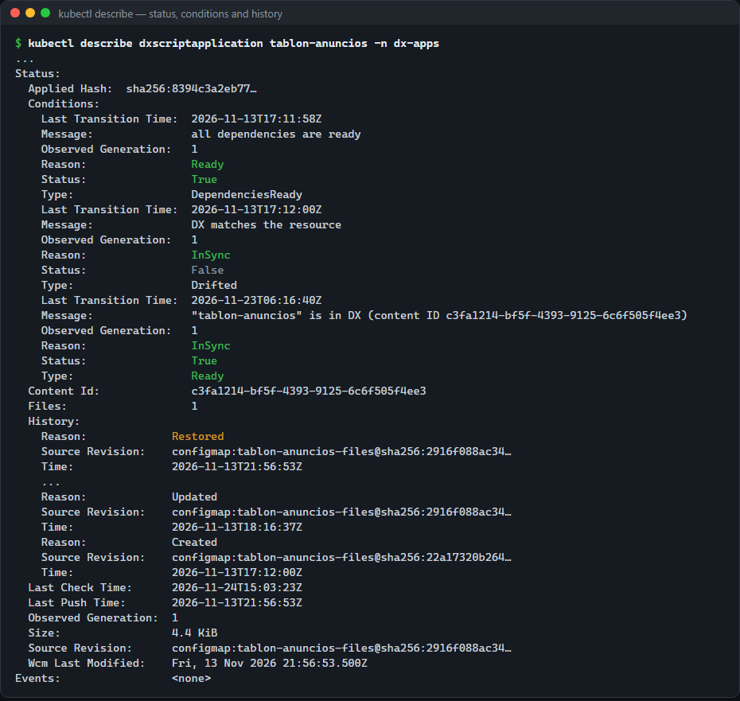
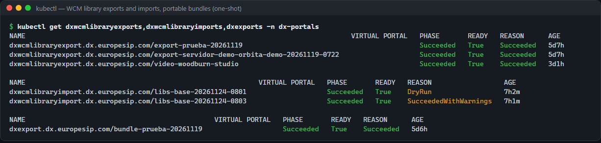

# DX Delivery Operator

**English** · [Español](index.es.md) · [Source on GitHub](https://github.com/europesip/dx-delivery-operator)

**Deliver HCL DX applications and content from Git, the Kubernetes way.** Declare a Script Application, its pages,
its DAM files, its database, a theme or a Java portlet in YAML; the operator puts them in DX, reports their state in
Kubernetes and puts them back when someone changes or deletes them in DX. It also moves WCM libraries, pages and whole
portal bundles between portals as OCI artifacts.

| | |
|---|---|
| **For** | Teams that run HCL DX Compose (or DX Core) on Kubernetes and deliver their own applications and content |
| **The problem** | DXClient pushes are one-off, imperative steps: nothing in Kubernetes knows what is in DX, every change is a full re-run, pages, DAM and databases need scripts, and changes made by hand in DX go unnoticed |
| **What it does** | Turns each piece into a **resource with a desired state and a status**, reconciled continuously against DX |
| **Value** | GitOps for DX (Argo CD shows health), the same build in every environment, drift detection and restore, safe deletes, content moved between portals in a standard format |

It is not an HCL product. Tested on HCL DX Compose CF239 on k3s (Kubernetes 1.35).



## How it fits



## Features

| Area | Resources | What you get |
|---|---|---|
| **Deliver applications** | `DXScriptApplication`, `DXPage`, `DXDamCollection`, `DXTheme`, `DXDatabase` | A Script Application from an OCI image, a ConfigMap or a URL, with per-environment `substitutions`; its pages, DAM files (stable URLs), theme and backend database. Pushed only when something changed; restored when deleted or edited in DX |
| **Move content between portals** | `DXWCMLibraryExport`, `DXWCMLibraryImport`, `DXExport`, `DXXMLAccess` | WCM libraries, the Portal Site, pages and XMLAccess as OCI artifacts in your registry, with a dry run first, automatic chunks, virtual portals; to and from DX Compose, DX Core and traditional DX on WebSphere |
| **Custom Java on DX Compose** | `DXJavaExtension` | JSR 168/286 portlets and shared-library JARs loaded onto the **official** Web Engine image (no custom image), rolled out one pod at a time with rollback, portlets registered automatically. Running custom Java on DX Compose requires the customer's entitlement to HCL's **Java Transition Module** (JTM) |
| **Maintain WCM** | `DXWCMAdminTask` | The member fixer and the workflow checker, in report mode unless you ask to fix |
| **Every resource** | | `dependsOn` (backend first), drift policy (`Restore` / `Report`), deletion policy (`Retain` / `Delete`), `suspend`, conditions, Kubernetes events, Argo CD health checks |

Every resource, in detail: [Features](features.md) · every field: [API reference](reference.md).

## Quick start

Requirements: Kubernetes 1.28+, Helm 3.8+, a DX user (Editor on the Script Application Library; pages and DAM need a
DX administrator). **No registry login**: the chart and the images are public.

1. **Install.** The operator image includes HCL DXClient, HCL software under its own licence
   ([LICENSE-DXClient.md](https://github.com/europesip/dx-delivery-operator/blob/main/LICENSE-DXClient.md)): read it (`docker run --rm hclcr.io/dx-public/dxclient:v95_CF239_20261103-1404 /dxclient/bin/dxclient accept-license`) and accept it.

   ```bash
   helm upgrade --install dxop oci://ghcr.io/europesip/charts/dx-delivery-operator --version 0.15.0 \
     -n dxop-system --create-namespace --set dxclient.acceptLicense=true
   ```

2. **Connect to DX** from the namespace of your applications (the CA only for a self-signed or private certificate):

   ```bash
   kubectl create namespace intranet
   kubectl -n intranet create secret generic dx-admin --from-literal=username='<DX user>' --from-literal=password='<password>'
   kubectl -n intranet create secret generic dx-ca --from-file=ca.crt=dx-ca.crt
   ```

   ```yaml
   apiVersion: dx.europesip.com/v1alpha1
   kind: DXConnection
   metadata: { name: dx }
   spec:
     url: https://dx.example.com
     portalCredentialsSecret: { name: dx-admin }
     tlsCASecret: { name: dx-ca }
   ```

3. **Deliver an application and its page:**

   ```yaml
   apiVersion: dx.europesip.com/v1alpha1
   kind: DXScriptApplication
   metadata: { name: time-off }
   spec:
     connectionRef: { name: dx }
     source:
       image: { ref: ghcr.io/acme/time-off:2.3.0, path: /app }   # the built app (dist/)
     wcm: { title: "Time off" }
     substitutions:
       - { name: API_URL, value: /time-off-api }                 # ${API_URL} in the files
     dependsOn:
       - { kind: Deployment, name: time-off-api }                # push only when the backend is up
   ---
   apiVersion: dx.europesip.com/v1alpha1
   kind: DXPage
   metadata: { name: time-off }
   spec:
     connectionRef: { name: dx }
     titles: { en: "Time off", es: "Vacaciones" }
     applications: [{ name: time-off }]
   ```

4. **Watch it:**

   ```bash
   kubectl -n intranet get dxconnections,dxscriptapplications,dxpages
   kubectl -n intranet get events --field-selector involvedObject.kind=DXScriptApplication
   kubectl -n intranet annotate dxscriptapplication time-off dx.europesip.com/reconcile="$(date +%s)" --overwrite  # force now
   ```

Values of the chart: [values.yaml](https://github.com/europesip/dx-delivery-operator/blob/main/charts/dx-delivery-operator/values.yaml) (for example `watchNamespaces`).
Step-by-step guides: [Migrate a portal](migration-guide.md) · [Java extensions](java-extensions.md) ·
[DX Core](dx-core.md).

## See it working

| | |
|---|---|
|  | **Status you can trust.** Conditions say whether the dependencies are ready, whether DX matches the resource and the content ID in DX. The history records every push: `Created`, `Updated` and `Restored` (someone deleted or edited it in DX, the operator put it back) |
|  | **Content between portals.** WCM library exports to OCI artifacts, imports with a dry run first (`DryRun`) and warnings reported, and portable bundles, all as one-shot resources |
|  | **In the portal.** Three sample Script Applications on one page created by the operator: a DAM image, an application with folders of files and a ConfigMap one |

Video: [Java portlets on HCL DX Compose without a custom image](https://youtu.be/bvTHifIU8nA) (8 min, subtitles EN/ES).

## Platforms

| | |
|---|---|
| **DX** | DX Compose (default, tested on CF239); [DX Core](dx-core.md) (`runtime: core`); traditional DX on WebSphere as source or target of exports and imports |
| **Kubernetes** | 1.28+; tested on k3s. The same chart runs on **OpenShift** (`restricted-v2`, no fixed UID, OpenShift service CA) without extra values, but it **has not been tested on OpenShift yet**: [OpenShift and other platforms](openshift.md) |
| **Install** | Helm chart `oci://ghcr.io/europesip/charts/dx-delivery-operator`; an OLM bundle generated from it (`make bundle`) is published on [OperatorHub.io](https://operatorhub.io/operator/dx-delivery-operator); the OpenShift community catalog submission is in review ([details](openshift.md#operatorhub-olm-bundle)) |
| **Databases** (`DXDatabase`) | PostgreSQL, Oracle, SQL Server (existing servers) |

## Documentation

| | |
|---|---|
| [Features](features.md) | Every resource and what the operator does with it |
| [How it works](how-it-works.md) | The pieces, the reconciliation loop of each resource, concurrency, status and events |
| [Guide: migrate a portal, XMLAccess](migration-guide.md) | Libraries, Portal Site, pages, themes and XMLAccess requests |
| [Portable bundles](portable-bundles.md) · [Artifact annotations](artifact-annotations.md) | The `DXExport` format and the annotations every artifact carries |
| [Java extensions](java-extensions.md) | `DXJavaExtension`: custom Java on the official Web Engine image |
| [WCM maintenance modules](wcm-admin-tasks.md) · [DX Core](dx-core.md) · [OpenShift](openshift.md) | Specific cases |
| [Restrictions and limitations](limitations.md) · [Secret fields](secret-fields.md) | What DX allows; whose credentials go where |
| [API reference](reference.md) | Every field of every resource, generated from the CRDs |
| [How we work](workflow.md) | Issues, the project board and the specs |

The same pages are published as TechDocs in Backstage (`mkdocs.yml`).

## Licence

MIT ([LICENSE](https://github.com/europesip/dx-delivery-operator/blob/main/LICENSE)) for this repository. The operator image contains HCL DXClient under HCL's licence
([LICENSE-DXClient.md](https://github.com/europesip/dx-delivery-operator/blob/main/LICENSE-DXClient.md)). HCL, HCL Digital Experience and DXClient are trademarks of HCL
Technologies Ltd. Made by [EUROPESIP](https://www.europesip.com).
